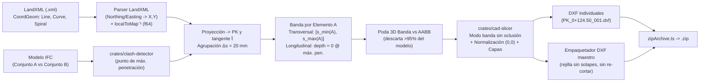

# 12 — Planos DXF de choques perpendiculares a alineación LandXML (F1–F5)

**Estado:** **F1–F5 implementadas y verificadas** (2026-11-23).  
**Alcance:** carga de alineaciones horizontales LandXML, generación por lotes de secciones transversales DXF perpendiculares al eje para cada choque entre **Conjunto A** y **Conjunto B**, DXF maestro sin solapes y reimportación round-trip DXF → IFC mediante parcheo quirúrgico STEP.

---

## 1. Requisitos de ingeniería y generalización

1. **100 % genérico (sin clases IFC fijas en código):**
   - Opera directamente sobre los dos conjuntos seleccionados en detección de choques: **Conjunto A** (elemento de referencia, p. ej. `IfcReinforcingBar` en puentes o `IfcPipeSegment` en MEP) frente a **Conjunto B** (elemento colisionante, p. ej. `IfcTendon` o `IfcDuctSegment`).
   - Aplicable a puentes (armaduras vs. pretensado), MEP, estructura o edificación.
2. **Secciones verticales perpendiculares al eje horizontal LandXML:**
   - El plano de corte es vertical con normal igual a la tangente horizontal unitaria $\hat{t} = (t_x, t_y, 0)$ de la alineación LandXML en el punto kilométrico (`PK`) proyectado del choque.
   - Se representa la **sección completa del modelo** (todo el ancho y alto en ese `PK`) para dar orientación geométrica completa al proyectista/ferralla.
3. **Profundidad exacta por Elemento A (transversal frente a longitudinal):**
   - Se proyectan todos los vértices `f64` del **Elemento A** sobre $\hat{t}$ para obtener $[s_{\min}, s_{\max}]$ y su extensión longitudinal $\Delta s_A = s_{\max} - s_{\min}$.
   - **Elemento A transversal / compacto:** la banda de corte es exactamente **$[s_{\min}, s_{\max}]$** (cubre el 100 % del elemento A independientemente de si el choque ocurrió en su cara inicial, central o final).
   - **Elemento A longitudinal** (paralelo a la alineación, p. ej. barra longitudinal o tubería larga): **corte de profundidad `0`** (plano 2D puro) en el **punto de máxima penetración**.
4. **Todos los elementos visibles (nada oculto):**
   - Se dibujan todos los elementos que intersectan esa banda delgada (hormigón, todas las armaduras, vainas/tendones, instalaciones, etc.) sin ocultar nada y **sin pase costoso de eliminación de líneas ocultas**.
5. **Agrupación por `PK` (`20 mm` por defecto, configurable):**
   - Los choques separados menos de `mergeToleranceMm` (`20 mm` por defecto; `0` desactiva la fusión) a lo largo del eje se agrupan en una única sección DXF.
6. **Coordenadas, capas y DXF maestro:**
   - Cada DXF individual se normaliza a **`(0, 0)`** (esquina inferior izquierda de su caja 2D) en **metros (`m`)** por defecto.
   - Capas DXF diferenciadas: geometría del modelo por clase/material IFC, `CLASH_A`, `CLASH_B`, `CLASH_MARKER`, `ALIGNMENT_AXIS` y `ANNOTATION`.
   - Salida en un único `.zip` que contiene **todos los DXF individuales**, **un DXF maestro combinado sin solapes** (`clashes_all.dxf`) y un índice `summary.csv`.

---

## 2. Arquitectura y flujo de datos

---

## 3. Diseño de componentes

### 3.1 Parser LandXML de alineación horizontal (`src/domain/alignment/landXml.ts`)
Reutiliza [src/domain/xml/xmlTree.ts](../src/domain/xml/xmlTree.ts) (extraído desde `src/ui/viewer/xmlTree.ts` para mantener el dominio desacoplado de la UI, sin nuevas dependencias externas) y opera en `f64`:
- **Elementos LandXML 1.2 soportados (verificados sobre exportación real de Istram 25.11):**
  - `<Units><Metric linearUnit="meter|millimeter" angularUnit="grads|decimal degrees|radians" directionUnit="grads|decimal degrees|radians"/>`: soporte explícito de **grados centesimales (`grads`, 400 gon = 360°)** además de grados sexagesimales y radianes; longitudes normalizadas a metros.
  - `<Alignments><Alignment name="..." staStart="...">`: soporta **`staStart` negativo** (p. ej. `-1446.73`) y selección cuando hay varios ejes.
  - `<CoordGeom>`:
    - `<Line>`: `<Start>` → `<End>`, proyección analítica exacta.
    - `<Curve rot="cw|ccw" radius="...">`: `<Start>`, `
`, `<End>`, proyección polar exacta sobre el arco.
    - `<Spiral spiType="clothoid" desc="TangentToCurve|CurveToTangent" rot="cw|ccw" length="..." radiusStart="..." radiusEnd="..." constant="...">`: evaluación por serie de Fresnel/Taylor en `f64` (incluidas curvas en S) + proyección en dos fases (muestreo grueso + Newton-Raphson).
- **Orden de coordenadas y georreferenciación:**
  - LandXML almacena `<Start>`/`<End>`/`
` como **`Northing Easting`** (`Y X`); el parser los convierte explícitamente a `(Easting, Northing) = (X, Y)`.
  - Transformación al espacio local del modelo IFC mediante la inversa de `ModelRecord.coordinateReference.localToMap` en `f64` (verificado con `IfcMapConversion` de Allplan `IFC4X3_ADD2`). Sin `IfcMapConversion`, se asume marco común y se emite aviso si las cajas 2D no solapan.

### 3.2 Punto de máxima penetración en `crates/clash-detector`
- En `crates/clash-detector/src/narrow.rs`, garantizar que `ClashOutcome::Hard.point` corresponda al **punto de máxima penetración** (tanto en ruta CSG como en intersección directa triángulo-triángulo), asegurando que los cortes longitudinales (`depth = 0`) caigan en la sección más crítica.

### 3.3 Clasificación transversal/longitudinal y agrupación por `PK`
- **Clasificación genérica del Elemento A:**
  1. Proyectar los vértices `f64` de Elemento A sobre $\hat{t} = (t_x, t_y, 0)$ → $[s_{\min}, s_{\max}]$, $\Delta s_A = s_{\max} - s_{\min}$.
  2. Proyectar sobre el plano transversal $(\hat{r}, \hat{z})$ → extensión $(w_{\perp}, h_{\perp})$.
  3. **Longitudinal** si $\Delta s_A > 0{,}15\text{ m}$ y $\Delta s_A > 2{,}5 \times \max(w_{\perp}, h_{\perp})$ → corte **`depth = 0`** en $s_{\text{cut}} = p_{\text{clash}} \cdot \hat{t}$.
  4. **Transversal / compacto** en caso contrario → banda exacta **`[s_min, s_max]`** (con tope de seguridad configurable, p. ej. `0,25 m`, para piezas muy oblicuas).
- **Agrupación (`mergeToleranceMm`, defecto `20 mm`):**
  - Ordenar choques por `PK` y fusionar choques consecutivos a $\le 20\text{ mm}$.
  - Si el grupo incluye algún Elemento A transversal, se toma la unión de sus bandas $[s_{\min}, s_{\max}]$; si todos son longitudinales, `depth = 0` en el choque de mayor penetración. Todos los elementos colisionantes del grupo se resaltan en `CLASH_A`, `CLASH_B` y `CLASH_MARKER`.

### 3.4 Corte rápido sin oclusión, metadatos round-trip y DXF maestro (`crates/cad-slicer`, `crates/wasm-api`)
Presupuesto de CPU y RAM para puentes con >20 000 barras y cientos de choques:
1. **Poda 3D Banda vs. AABB en el `ModelWorker`:** antes de evaluar o serializar mallas, se proyecta la AABB de cada elemento sobre $\hat{t}$ (4 operaciones en coma flotante) y se descartan los elementos fuera de $[s_{\min} - \varepsilon, s_{\max} + \varepsilon]$ (>95 % de la longitud del puente).
2. **Modo banda sin oclusión en `crates/cad-slicer`:**
   - Con `depth == 0`: solo lazos de corte (`cut::slice`), sin proyección.
   - Con `depth > 0`: lazos de corte en $s_{\min}$ + aristas recortadas a la banda $[s_{\min}, s_{\max}]$ proyectadas al plano **sin construir ni consultar la BVH de oclusión** (ahorra ~80–90 % del tiempo de CPU y cumple «nada oculto»).
3. **Normalización a `(0, 0)`, capas y contrato round-trip:**
   - Trasladar cada dibujo individual para que su caja 2D comience en `(0, 0)` en **metros (`m`)**.
   - Capas DXF R12: geometría del modelo por clase/material, `CLASH_A` (ACI 1 rojo), `CLASH_B` (ACI 4 cian), `CLASH_MARKER` (ACI 2 amarillo), `ALIGNMENT_AXIS` (ACI 3 verde) y `ANNOTATION` (`PK`, profundidad, nombres/IDs y penetración en mm).
   - **Metadatos round-trip (para Fase F5):** comentario `999` / capa bloqueada `GUBIM_META` con `modelId`, `PK`, marco 3D (`origin`, `right`, `up`, `look`), desplazamiento `(minX, minY)` y banda $[s_{\min}, s_{\max}]$; cada elemento `CLASH_A` se exporta como **`BLOCK` + `INSERT`** con nombre (`GUBIM_A_<expressId>_<GlobalId>`) y, para barras planas transversales, polilínea de eje etiquetada `EDIT_A_<expressId>`.
4. **DXF maestro sin solapes (`clashes_all.dxf`):**
   - `cad_slicer::merge_drawings_grid` toma los `Drawing` ya cortados y normalizados a `[0, W] × [0, H]` (sin re-cortar), los ordena por `PK` y los dispone en una rejilla 2D sin solapes con márgenes uniformes y rótulo `PK` en la capa `SHEET_FRAME`.
5. **Canalización secuencial en un único Worker:**
   - Procesamiento secuencial con barra de progreso y cancelación (`AbortSignal`), escribiendo cada DXF en el `.zip` (`individual/PK_...dxf` + `clashes_all.dxf` + `summary.csv`) sin mantener múltiples Workers ni copias completas en memoria.

### 3.5 Fase F5: Reimportación DXF y parcheo quirúrgico STEP IFC
Permite que el equipo de delineación corrija las barras directamente en los DXF y recargue los cambios en VisorGuBIMGal:
1. **Lectura y diferencia DXF:** lee `GUBIM_META` y compara cada `INSERT` `GUBIM_A_<expressId>_<GlobalId>` (y polilínea `EDIT_A_<expressId>`) con su posición original:
   - **Nivel 1 — Desplazamiento (`MOVE`, barras transversales y longitudinales):** $(\Delta x, \Delta y) \mapsto \Delta\mathbf{P}_{3D} = \Delta x \cdot \hat{r} + \Delta y \cdot \hat{u}$.
   - **Nivel 2 — Redoblado plano en 2D (barras transversales):** eleva los vértices editados de la `LWPOLYLINE` al plano 3D y genera un nuevo `IfcSweptDiskSolid` (`IfcIndexedPolyCurve` + `NominalDiameter`).
   - *(Los quiebros 3D locales de barras longitudinales desde una sola sección 2D quedan fuera de alcance salvo desplazamiento completo de Nivel 1.)*
2. **Parcheador quirúrgico STEP (Rust):** conserva el 99,99 % del IFC original byte a byte (GUIDs, propiedades, hormigón, tendones y ejes intactos); solo añade las entidades nuevas al final de `DATA;` (`IfcCartesianPoint`/`IfcLocalPlacement` o `IfcSweptDiskSolid`) y actualiza la referencia en la entidad modificada.
3. **Verificación automática:** recarga el IFC parcheado, re-ejecuta la detección de choques para confirmar 0 choques pendientes y exporta el `.ifc` actualizado más un registro CSV/BCF de desplazamientos.

---

## 4. Plan de fases y verificación

| Fase | Estado | Entregable implementado | Pruebas ejecutadas |
|---|---|---|---|
| **F1** | **Hecho** | [`src/domain/xml/xmlTree.ts`](../src/domain/xml/xmlTree.ts), [`src/domain/alignment/landXml.ts`](../src/domain/alignment/landXml.ts) (`Line`, `Curve`, `Spiral` clotoide por cuadratura Gauss-Legendre 8 pts + Newton-Raphson, `grads`/deg/rad, `staStart` negativo, `Northing Easting`, `localToMap⁻¹`, `formatStationPk`) | [`test/t170-landxml-test.mjs`](../test/t170-landxml-test.mjs) (**7/7 pass**) |
| **F2** | **Hecho** | Punto de máx. penetración CSG y fallback en [`crates/clash-detector/src/narrow.rs`](../crates/clash-detector/src/narrow.rs) + `Bvh3::visit_closest_to_point` en [`bvh.rs`](../crates/clash-detector/src/bvh.rs); clasificación transversal/longitudinal y agrupación PK `20 mm` en [`crates/clash-detector/src/slab.rs`](../crates/clash-detector/src/slab.rs) | `cargo test -p clash-detector` (**13/13 pass**, incl. [`tests/slab.rs`](../crates/clash-detector/tests/slab.rs)) |
| **F3** | **Hecho** | Poda 3D banda-AABB (`Model::cullElementsBySlab`, `slabChunkForElements`) y `ClashBatchSlicer` en [`crates/wasm-api/src/loaded.rs`](../crates/wasm-api/src/loaded.rs) y [`clash_dxf.rs`](../crates/wasm-api/src/clash_dxf.rs); modo banda sin oclusión en [`crates/cad-slicer/src/project.rs`](../crates/cad-slicer/src/project.rs) y [`lib.rs`](../crates/cad-slicer/src/lib.rs); `(0,0)` en metros, capas `CLASH_*`, `GUBIM_META`/`GUBIM_ORIG`/`BLOCK`/`INSERT` y `merge_drawings_grid` en [`crates/cad-slicer/src/clash_dxf.rs`](../crates/cad-slicer/src/clash_dxf.rs) | `cargo test -p cad-slicer --test clash_dxf` (**3/3 pass**, 50 secciones sin solape < 50 ms/sección) + `npm run test:drawings` (**31/31 pass**) |
| **F4** | **Hecho** | Planificador [`src/domain/alignment/clashDxfPlan.ts`](../src/domain/alignment/clashDxfPlan.ts), canalización secuencial en Worker único con progreso/`AbortSignal` en [`WasmKernelAdapter.ts`](../src/infrastructure/kernel/WasmKernelAdapter.ts) y [`kernel.worker.ts`](../src/infrastructure/kernel/kernel.worker.ts), empaquetado `.zip` + vista previa SVG en [`clashAlignmentExport.ts`](../src/ui/viewer/clashAlignmentExport.ts) y [`ClashPanel.tsx`](../src/ui/components/ClashPanel.tsx) | [`test/t171-clash-dxf-export-test.mjs`](../test/t171-clash-dxf-export-test.mjs) (**3/3 pass** contra WASM real) + `npm run typecheck` (0 errores) + `npm run test:unit` (**18/18 suites pass**) |
| **F5** | **Hecho** | Lector y diferencia DXF (`GUBIM_META`/`GUBIM_ORIG`/`GUBIM_POLY`/`INSERT`/`POLYLINE`/`LWPOLYLINE`) en [`crates/cad-slicer/src/roundtrip.rs`](../crates/cad-slicer/src/roundtrip.rs), parcheador quirúrgico STEP Nivel 1 (`IfcLocalPlacement` con cadena de rotaciones padre) y Nivel 2 (`IfcSweptDiskSolid` con radio automático y marco local) en [`crates/step-parser/src/patch.rs`](../crates/step-parser/src/patch.rs), fachada WASM (`Model.applyClashDxf`, `patchIfcStepFromDxf`), Worker/puerto (`KernelPort.applyClashDxfRoundTrip`) y botón de reimportación + recarga automática + descarga IFC/CSV en [`ClashPanel.tsx`](../src/ui/components/ClashPanel.tsx) y [`clashRoundTrip.ts`](../src/ui/viewer/clashRoundTrip.ts) | `cargo test -p wasm-api --test roundtrip_dxf_step` (**4/4 pass**: Nivel 1 `MOVE`, rotaciones padre de `IfcLocalPlacement` y Nivel 2 `EDIT_A_*` → **0 choques** y GUIDs intactos) + `t171-clash-dxf-export-test.mjs` (**3/3 pass**) + `cargo clippy --workspace --all-targets -- -D warnings` (0 avisos) |

> **Pendiente opcional de verificación en navegador:** ejecutar `npm run test:e2e` en un entorno con Chromium/Playwright para validar el flujo completo de UI en navegador y revisar el parcheo Level 1 sobre modelos reales con rotaciones anidadas de `IfcLocalPlacement` (si el padre tiene rotación distinta de identidad).

---

## 5. Impacto en el contrato (`docs/05_kernel_contract.md`)
- Documentado en **`docs/05_kernel_contract.md` v2, revisión 13**: extensión estrictamente aditiva con los métodos opcionales `elementSlabSpan?`, `exportClashAlignmentDxf?` y `applyClashDxfRoundTrip?` en `KernelPort`, sin cambios rupturistas en `GeometryBatch` v2, `RendererPort` ni la caché OPFS.
- Extensión aditiva en mensajes de Worker para cortes por lotes en banda sin oclusión y round-trip STEP; retrocompatible con las 31 pruebas de regresión de `test:drawings`.
