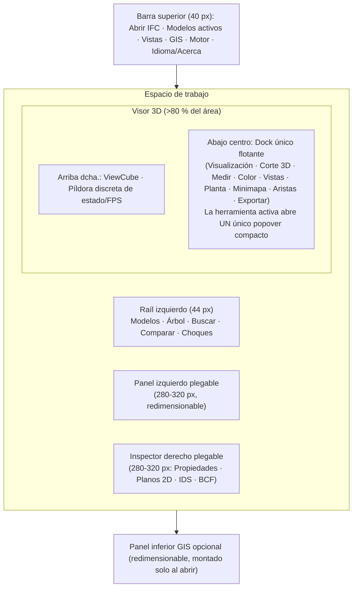

# 13 — Propuesta de rediseño UI/UX y migración a SolidJS (U0–U2)

**Estado:** propuesta para el siguiente sprint.  
**Alcance:** renovación completa de la interfaz hacia una experiencia CAD/BIM limpia y sustitución de React 18 por **SolidJS** (manteniendo Vite 7, el kernel Rust/WASM, el renderizador WebGPU/WebGL2 y `FilePort` sin cambios).

---

## 1. Motivación

El motor técnico de VisorGuBIMGal ya es soberano y rápido (`crates/*` + renderizador WebGPU/WebGL2 propio), pero la capa de interfaz arrastra deuda visual y estructural:
- **Saturación visual:** hasta **5 barras flotantes apiladas** sobre el lienzo 3D (`DisplayBar`, `SectionBar`, `MeasureBar`, `ColorByBar`, `SavedViewsBar`), dos paneles laterales fijos (5 pestañas a la izquierda y 4 a la derecha), cabecera, barra del visor, ViewCube, minimapa y panel GIS inferior.
- **Componente monolítico:** [App.tsx](../src/App.tsx) supera las 1 500 líneas con ~30 `useState`/`useRef`, efectos `useEffect` sincronizando el renderizador imperativo y contenedores ocultos con `display: none` para preservar estado entre pestañas.
- **Estilos globales:** [index.css](../src/ui/styles/index.css) (1 566 líneas) mezclado con estilos en línea.

Aprovechar el rediseño UI/UX para migrar de **React 18 a SolidJS** (MIT, ~7 KB, sin Virtual DOM, reactividad fina por señales) evita portar componentes obsoletos 1:1 y encaja de forma natural con un visor CAD/BIM imperativo.

---

## 2. Nuevo diseño de espacio de trabajo CAD/BIM

Objetivo: **dedicar más del 80 % de la pantalla al visor 3D**, mostrando solo la herramienta activa en cada momento.

### Mejoras clave de UX y accesibilidad
- **Dock único flotante inferior:** sustituye las 5 barras apiladas de `.viewport-tools`. Al pulsar una herramienta se abre un único popover compacto sobre el dock.
- **Paneles laterales plegables y redimensionables:** el raíl de 44 px abre/cierra el panel izquierdo; el inspector derecho se pliega libremente y puede abrirse al seleccionar un elemento.
- **Sin `display: none`:** el estado de búsqueda, comparación, choques, IDS y BCF pasa a almacenes `.ts`, de modo que desmontar una pestaña no pierde resultados.
- **Sistema de diseño modular:** `src/ui/styles/tokens.css` (jerarquía de superficies, tipografía tabular para cotas y coordenadas, contraste WCAG AA) + CSS Modules (`*.module.css`) nativos de Vite.
- **Atajos de teclado CAD y A11y:** `F` (encuadrar), `H` (ocultar), `I` (aislar), `M` (medir), `Esc` (salir/limpiar), `1–6` (vistas), `:focus-visible` y anuncios `aria-live`.

---

## 3. Arquitectura: almacenes agnósticos + SolidJS

Extraer todo el estado y orquestación de `App.tsx` a almacenes planos en `src/ui/stores/` (siguiendo el patrón de [MeasureController.ts](../src/ui/viewer/MeasureController.ts)):

| Almacén (`src/ui/stores/`) | Responsabilidad | Sinergia directa |
|---|---|---|
| `modelsStore.ts` | Federación `ModelRecord[]`, `spatialTrees`, carga/reintento, mapas `refKey <-> GlobalId`, diagnósticos | Frontera limpia con `KernelPort` |
| `selectionStore.ts` | Selección, hover, detalles del elemento y zoom a selección | Elimina estado muerto en `App.tsx` |
| `displayStore.ts` | `displayRule`, color por propiedad/leyenda, overrides de comparación y choques | Efecto único hacia `renderer` |
| `sectionStore.ts` | Planos/caja de corte 3D y selección de cara | Compartido entre dock 3D y panel 2D DXF |
| `viewsStore.ts` | Vistas guardadas (captura/restauración) | **Persistencia directa en IndexedDB (P1)** |
| `bcfStore.ts` | Temas, comentarios y puntos de vista BCF | **Persistencia directa en IndexedDB (P1)** |
| `clashStore.ts` | Reglas, resultados y estado de exportación DXF | **Persistencia directa en IndexedDB (P1)** |
| `workspaceStore.ts` | Paneles activos, herramienta del dock, GIS, recorrido por planta, minimapa e idioma | Conecta `setLocale` para **C18 (`es`/`gl`/`en`)** |

### Saneamiento hexagonal incluido
1. Inyectar `filePort` desde composición/props en lugar de importarlo directamente en `Header` y `BcfPanel`.
2. Mover tipos de `modelRetry` fuera de `src/ui/viewer/` para que `WasmKernelAdapter.ts` no importe desde `ui/`.
3. Aislar `proj4` tras puerto de dominio si se busca pureza estricta en `Coordinates.ts`.

---

## 4. Cambio de dependencias (todo MIT / ISC)

- **Se mantiene:** `vite` 7 (`vite.config.ts` sigue en ~18 líneas), `typescript`, `leaflet`, `proj4`, todos los crates Rust y las baterías de pruebas (`test:unit`, `test:drawings`, `test:e2e`).
- **Se elimina:** `react`, `react-dom`, `@types/react`, `@types/react-dom`, `@vitejs/plugin-react`, `lucide-react`.
- **Se añade:** `solid-js` (MIT), `vite-plugin-solid` (MIT) y `lucide-solid` (ISC) — o mapa local de iconos SVG sin dependencias.

---

## 5. Fases de migración (protegiendo las 24 suites E2E)

1. **U0 — Extracción de almacenes y contrato E2E (aún en React):**
   - Extraer `src/ui/stores/*` desde `App.tsx` con pruebas unitarias.
   - Añadir atributos estables `data-testid` manteniendo las clases existentes durante la transición para desacoplar `test/e2e/tc.mjs` y `e2e.mjs` del diseño visual.
   - Puerta: 16 suites unitarias + 32 de planos + 24 E2E en verde.
2. **U1 — Carcasa SolidJS y visor principal (`feat/ui-solid-shell`):**
   - Cambiar `vite.config.ts` y `tsconfig.json` (`jsxImportSource: "solid-js"`).
   - Construir `TopBar`, `LeftRail` + panel plegable, `BimViewer` (lienzo, ViewCube, estado/FPS, `MeasureOverlay`, `Minimap`), `BottomDock`, `ModelsPanel`, `SpatialTreePanel` y `PropertiesPanel`.
   - Puerta: `tc.mjs` (TC-001..008) en verde en WebGPU, WebGL2 y sin adaptador.
3. **U2 — Paneles de coordinación, planos 2D y GIS:**
   - Portar `SectionDxfPanel`, `SearchPanel`, `ComparePanel`, `ClashPanel`, `IdsPanel`, `BcfPanel` y `GisMapPanel` sobre los nuevos almacenes y CSS Modules.
   - Puerta: `npm test` completo en verde + actualización controlada de capturas `test/e2e/ref/`.

---

## 6. Paralelismo con E9 (Win32 + WebView2)
La carcasa de escritorio interactúa exclusivamente mediante `FilePort` (`src/domain/files/FilePort.ts`) y `vite build` (`base: './'`). **E9** y el bloque **U0–U2** no comparten archivos y pueden desarrollarse en paralelo.
